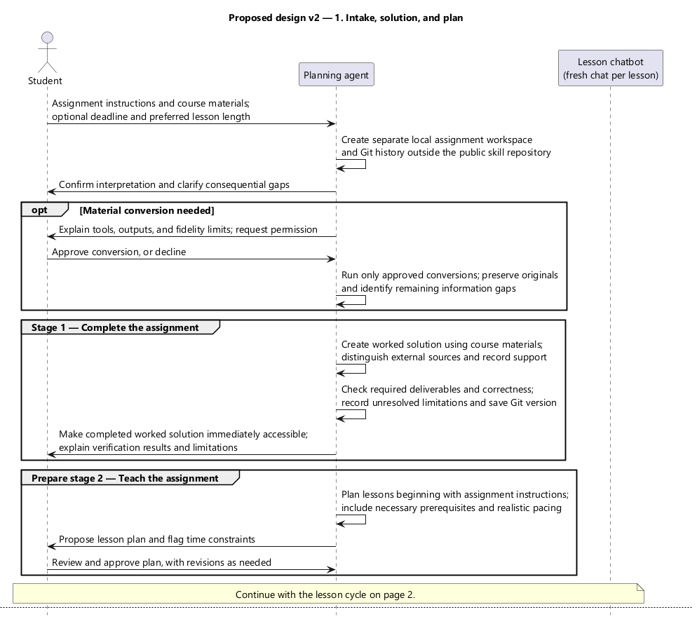
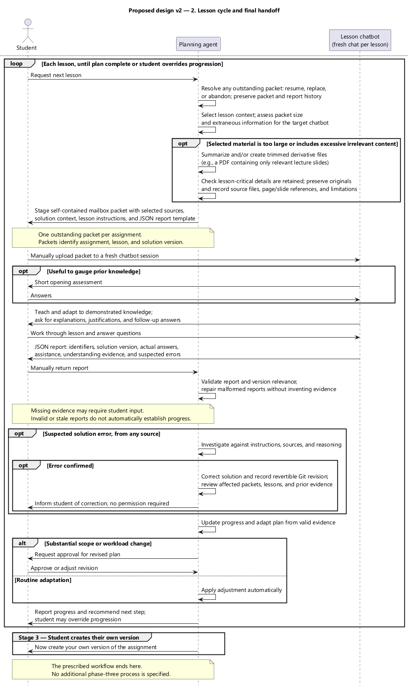
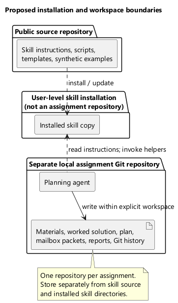

# invo-assignment design record

These are **accepted proposed-design** views, not descriptions of an existing implementation. The author agreed to the workflow and the source/installation/assignment boundaries in the 2026-10-23 design conversation and then requested the specification and public repository. The testing boundary in the specification was separately confirmed the same day.

Supporting document: [implementation specification](../../.scratch/assignment-workflow/spec.md).

## Workflow sequence

Scope: assignment intake and conversion approval, verified worked solution, approved teaching plan, mandatory manual packet/report cycle, packet reduction, report validation, plan adaptation, solution corrections, and the final prompt to create an original version.

The semantic version is the design discussion's **proposed design v2**. Publication adds source comments and reciprocal links without changing its behavior.

- [Authoritative PlantUML source](assignment-workflow.puml)
- [Intake, solution, and plan SVG](assignment-workflow.svg)
- [Lesson cycle and final handoff SVG](assignment-workflow_001.svg)
- Source SHA-256: `77CA25ABFFACC209FD4996D431D1395CCB0FD7A6D01DCF521D518BAB67B1CAA2`

## Installation and workspace boundaries

Scope: reusable source repository, user-level installed tooling, and one separate local repository per personal assignment. The planning-agent participant represents a session operating in that workspace, not an executable stored in Git.

- [Authoritative PlantUML source](installation-boundaries.puml)
- [SVG preview](installation-boundaries.svg)
- Source SHA-256: `F60CDEC89F58F75BF80EDDC583D1F98C7B6DBACF1EEBEB357D6D85D001537E58`

## Interpretation and limits

Read sequence messages from top to bottom. Optional branches describe conditional work; they do not introduce an additional approval beyond the message explicitly shown. The spec defines report-repair behavior and packet/version validity more precisely than the overview sequence.

The student can override progression recommendations; this does not turn missing assessment evidence into demonstrated understanding. Solution corrections can be discovered outside a lesson as well as through a report. The correction branch in the lesson-cycle panel illustrates the shared investigation, versioning, notification, and affected-context review behavior wherever a correction is triggered.

No unresolved diagram assumptions are known to block implementation. Exact commands, programming language, and storage layout are intentionally left to implementation within the specification's contracts.

## Rendering verification

Rendered locally on 2026-10-23 with PlantUML 1.2024.8, OpenJDK 25.0.4.101, and Segoe UI. Sequence views use built-in layout; the installation view selects bundled Smetana. SVG and PNG were regenerated from each authoritative source. The actual PNG previews were inspected for readable labels, branches, arrows, and consistency with the specification.

See [renderer configuration](../agents/uml-rendering.md) for reproducible commands. Source hashes identify the accepted publication snapshots; update the hashes if sources change, and obtain agreement on semantic revisions under the UML workflow.
